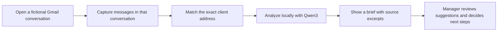

# Client Briefing

A local AI briefing assistant for bank relationship managers. While a manager reads a fictional client conversation in Gmail, a Chrome side panel gathers relevant recorded concerns, open commitments, goals, preferences, and message-specific communication signals—with the source evidence close at hand.

Prepared for **MLH Hacktoberfest Hack Day Barcelona 2026**, with a focus on **Best Open-Source AI Project**.

## Development tools

Gemini and OpenAI Codex were used as AI-assisted development tools while building this project. They supported development work; the shipped product's client-context analysis runs locally with Ollama and Qwen3.

## Why this project

Client conversations are spread across long email histories. Managers need to recover what a client has raised, what the manager promised, and what the client has said they want before the next conversation. Client Briefing uses a local language model to surface candidate context and supporting excerpts, while keeping confirmation and relationship decisions with the manager.

## How it works



The extension captures the currently open Gmail thread, including incoming messages and manager replies. Managers can also import fictional JSON history. The application validates client ownership and evidence, stores data in Chrome local storage, and asks local Ollama running `qwen3:1.7b` to suggest relevant context. Suggestions stay separate from manager-confirmed facts until reviewed.

## What is implemented

- Chrome Manifest V3 extension with a React side panel.
- Current-thread Gmail capture, including message IDs, direction, exact text, and manager replies.
- Explicit fictional history import, with source labels and coverage information.
- Exact-address client matching and client isolation.
- Local Qwen3 analysis with bounded suggestions and exact source-excerpt checks.
- Local persistence and cached analysis, including manager review state.
- Clear unavailable/error behavior; no canned answers when Ollama is unavailable.

The product has automated and synthetic-browser verification. Actual signed-in Chrome/Gmail acceptance and remaining end-to-end workflow checks are tracked in the [acceptance checklist](docs/sergi/implementation-checklist.md). This is a hackathon prototype, not a production banking tool.

## Try it locally

### Requirements

- Bun 1.4.3 and Node.js 22.12 or newer.
- Chrome 116 or newer.
- [Ollama](https://ollama.com/) with the `qwen3:1.7b` model for live analysis.
- A fictional Gmail inbox/thread for capture; never use real client information.

### Install and build

From the repository root:

```sh
bun install --frozen-lockfile
bun run typecheck
bun run test
bun run build
```

Load `apps/extension/.output/chrome-mv3` as an unpacked extension from `chrome://extensions` with Developer mode enabled. Pin **Client briefing**, open a fictional Gmail conversation, and click the extension toolbar button to open the side panel. For an unknown sender, register the client explicitly; registration creates an empty client record and does not seed facts or history.

Start Ollama locally with `qwen3:1.7b` and allow the extension origin using `OLLAMA_ORIGINS`. See the [team setup guide](setup-hacktoberfest.md) and [history import and rehearsal guide](docs/sergi/history-import.md) for detailed setup, local model configuration, and fictional JSON import format.

## Privacy and decision boundaries

- Only the currently open Gmail conversation is captured. The extension does not search or synchronize the mailbox and does not use Gmail OAuth.
- Email history, extracted context, and reviewed facts stay in `chrome.storage.local`; inference uses Ollama on the same computer.
- Unknown senders do not receive another client's context. Client matching and evidence validation are application rules, not model decisions.
- Model output is a suggestion. A matching quotation supports inspection but does not prove that an interpretation is correct.
- Communication signals refer to particular messages and topics; they are not permanent emotional profiles or manager scores.
- The extension does not send emails, set prices, or make financial decisions.
- Use fictional data only. See [architecture.md](architecture.md) for the full technical and data boundaries.

## Architecture

The TypeScript/Bun workspace uses ports and adapters to keep client-context rules independent of Chrome, storage, and model integrations.

| Path | Responsibility |
|---|---|
| `apps/extension/` | WXT, Gmail capture, extension messaging, and React side panel |
| `packages/contracts/` | Shared types and boundary validation |
| `packages/core/` | Client matching, evidence rules, and context services |
| `packages/infra/` | Chrome storage, history import, and local Ollama adapter |

See [architecture.md](architecture.md) for dependency rules and [research-bank-manager-sidebar.md](research-bank-manager-sidebar.md) for the product research and priorities.

## Team

| Member | Focus |
|---|---|
| Sergi | Foundation, shared contracts, side panel, and integration |
| Albert | Gmail/history and local AI/client-context work with Joana |
| Joana | Gmail/history and local AI/client-context work with Albert |

Implementation plans and the team workflow are in [docs/implementation_plans](docs/implementation_plans/README.md) and [setup-hacktoberfest.md](setup-hacktoberfest.md).

## License

Project code is licensed under the [MIT License](LICENSE). Third-party packages and model weights retain their respective licenses.
