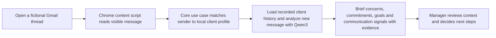

# Hacktoberfest Hack Day — Team Setup

This project-folder copy is the working team guide. Read [architecture.md](architecture.md) before implementing: it is authoritative and requires Sergi's prior permission for edits. Concise member plans are in [docs/implementation_plans](docs/implementation_plans/README.md); project skills and assistant rules are indexed in [AGENTS.md](AGENTS.md).

**Foundation implementation:** `feat/sidepanel-shell` adds the first Bun/WXT
workspace and empty panel. Current root commands are `bun install --frozen-lockfile`,
`bun run dev`, `bun run typecheck`, `bun run test` (Vitest), and `bun run build`.
Verified tooling: Bun 1.4.3, Node 22.22.2, WXT 0.20.27, React 19.3.1,
TypeScript 5.9.3 and Vitest 3.2.7. See the [README](README.md#run-locally) for
Chrome loading and the package/API handoff. The preparation instructions below
describe the original event plan; capture, local model, storage and review services are implemented, with remaining
acceptance work tracked in [the checklist](docs/sergi/implementation-checklist.md). Albert and Joana will work in parallel across both the Gmail/history
and local AI/context areas; Sergi coordinates shared contracts and integration.

## The idea

Build a local client briefing assistant for a bank relationship manager responsible for many clients. When the manager opens a fictional client email in Gmail, a Chrome side panel brings back the relevant history: recent concerns, unresolved requests and promises, stated goals and preferences, and recent communication signals with source excerpts. The manager uses this context to prepare conversations and make informed service or commercial decisions. Reply drafting is an optional secondary feature.

The model proposes information; the manager reviews it and decides how to handle the relationship. Communication signals describe particular messages and topics, with uncertainty; they do not establish a permanent emotional profile or measure the manager's performance. The prototype uses fictional data and leaves fees, offers and financial decisions with the manager.

See [bank manager research and sidebar proposal](research-bank-manager-sidebar.md) for the source findings, feature priorities, historical-data limits and demo measurement plan.



## Our target

Focus on **Best Open-Source AI Project**. Qwen3 is an open-weight model, and the model should do meaningful work in the demo: extract relevant client context from emails and support a concise briefing with evidence. Publish the project in a public GitHub repository with an open-source license. We are focusing our build and submission on this one category.

## Recommended stack

- **Workspace:** TypeScript monorepo managed from the root with Bun workspaces; commit bun.lock. Use apps/extension plus packages/contracts, packages/core and packages/infra, following architecture.md.
- **Architecture:** hexagonal/ports-and-adapters. Framework-independent contracts and core rules are separate from Chrome/Ollama adapters; the extension composes them.
- **Browser:** Chrome, Manifest V3 extension.
- **Extension framework/build:** WXT, which uses Vite and handles extension entry points and manifest generation.
- **Extension UI:** React + TypeScript in the Chrome Side Panel. Use ordinary React components; no Gmail-specific UI component is needed.
- **Tests:** Vitest with WXT's testing plugin and fake browser APIs. Prioritize client isolation, context updates, evidence validation and incomplete-history states.
- **Gmail integration:** a content script limited to `https://mail.google.com/*`; automatically read only the currently open fictional message, with an explicit panel action to import expanded messages from that same fictional thread. Do not use Gmail API or OAuth.
- **Context panel:** Chrome Side Panel API, opened from the extension toolbar button. Keep styling in the extension panel rather than injecting UI into Gmail.
- **AI:** Ollama local API with `qwen3:1.7b`.
- **Persistence:** `chrome.storage.local` for fictional message history, extracted context and confirmed profile facts. Import a small labeled sample history at the event; Gmail capture adds only messages actually viewed.
- **Styling:** plain CSS to start; avoid adding a component library during the five-hour sprint.
- **Repository:** GitHub, with the MIT License (recommended for this small prototype because its conditions are simple: preserve the copyright and license notice).

No database, cloud backend, or email-sending integration is needed for the prototype.

## Install and prepare before the event

Install these on your own laptop:

- [ ] A recent version of Chrome.
- [ ] Bun and a Node version compatible with the selected WXT/Vite version. Align versions at kickoff; use Bun for dependencies and Vitest for tests.
- [ ] Git and access to your GitHub account.
- [ ] Ollama for your operating system.
- [ ] The Qwen3 1.7B model. In a terminal, run:

  ```sh
  ollama pull qwen3:1.7b
  ollama list
  ollama run qwen3:1.7b
  ```

The model download is about 1.4 GB. Leave enough disk space for it. Run Ollama on the same laptop as Chrome.

**Confirmed on the project laptop:** Ollama with Qwen3 1.7B runs well and responds quickly. Teammates should still run the check above on their own laptops.

For Chrome to call Ollama from the extension, Ollama must allow the extension's origin through `OLLAMA_ORIGINS`. Prefer the specific Chrome extension ID once it exists; Ollama also documents `chrome-extension://*` for local extension development. Restart Ollama after changing this setting. Keep Ollama bound to the local machine; do not expose its port to the network.

The extension declares loopback host permissions for Ollama. After rebuilding,
reload it in `chrome://extensions/` so Chrome applies those permissions. Configure
`OLLAMA_ORIGINS` on the process that runs the Ollama server, rather than only in
an unrelated terminal. For a Linux systemd installation, run
`sudo systemctl edit ollama.service` and save these uncommented lines in the
editable area (replace `<extension-id>` with Chrome's actual extension ID):

```ini
[Service]
Environment="OLLAMA_ORIGINS=chrome-extension://<extension-id>"
```

Then run `sudo systemctl daemon-reload` and `sudo systemctl restart ollama`.
If the editor reports empty contents, the override was not saved. Keep existing
origin values if other local applications use them. The adapter disables Qwen
thinking, bounds output generation, and waits for model completion by default. An
explicit `timeoutMs` adapter setting can impose a deadline when needed. Invalid responses and connection failures show an unavailable state without substitute observations.

Tool installation and model download can be done ahead of time. The event description says work on the project submission must start at the event, so do not prepare project code or the sample inbox beforehand.

## Five-hour build scope

1. **Extension shell:** manifest, toolbar action, and a working side panel.
2. **Email context:** read the visible sender, subject, and body from one prepared Gmail test account. Use a small set of fictional threads created at the event.
3. **Recorded client history:** match by exact sender email and load a small fictional history containing client messages and manager replies. Show which sources are available.
4. **AI extraction:** ask Qwen for a bounded JSON response containing concerns, commitments, goals, preferences and message-specific communication signals, with exact source excerpts. Allow manager review and correction.
5. **Client briefing:** lead with what matters now and outstanding commitments; show goals/preferences and recent communication below, with expandable history and evidence. Calculate dates and counts from recorded data in code.
6. **Demo polish:** measure time to find key context, rehearse the flow, and show an honest empty/error state if Gmail or Ollama is unavailable.

After the main flow works, add the agreed stretch feature: review a possible change to a confirmed client preference, displaying old and new evidence before the manager approves replacement. Editable reply drafting can follow if time remains.

Keep the profile schema shallow. Missing information should stay empty or be marked unknown. Exact identifiers and financial values should be displayed from the source text rather than paraphrased. The model's JSON shape can be constrained, but that does not guarantee its facts are correct.

## Three-person work split

Agree on the shared types and message names together before splitting up. Put framework-independent value contracts in packages/contracts and port/use-case interfaces in packages/core. Keep the first contract small; the following is a working data sketch, not implemented code:

```ts
type EmailContext = {
  id: string;
  senderEmail: string;
  subject: string;
  body: string;
  sentAt?: string;
  direction: 'incoming' | 'outgoing';
  source: 'gmail' | 'demo-import';
};

type ContextItem = {
  id: string;
  kind: 'concern' | 'commitment' | 'goal' | 'preference' | 'communication_signal';
  text: string;
  sourceEmailId: string;
  sourceExcerpt: string;
  review: 'suggested' | 'confirmed' | 'dismissed';
};

type ClientProfile = {
  id: string;
  email: string;
  displayName: string;
  notes: string;
  items: ContextItem[];
};
```

Use exact sender email for matching. The side panel should render a clear no-match state. A suggested fact is not part of the profile until the manager accepts it.

The core AI use case is `analyzeEmail(email, profile)`, returning suggested context items through injected ports. Core assigns IDs/review state and validates attribution; the model supplies only candidate observations. A core briefing use case groups stored items into the brief. Let the manager confirm stable facts and mark concerns or commitments resolved through separate use cases. Keep communication signals tied to source messages. If added later, `draftReply(email, profile)` uses confirmed profile context only. Fictional-history and Chrome-storage adapters live in packages/infra; the extension composition root injects them into core.

| Teammate | Owns | Suggested branch |
|---|---|---|
| Sergi — critical path and integration lead | WXT foundation, shared contract, React side panel and end-to-end integration into `main`; keep the primary demo path working | `feat/sidepanel-shell` |
| Albert — shared feature work | Contribute in parallel across Gmail capture/history and local AI/client-context with Joana | `feat/gmail-context`, `feat/local-ai-profile` |
| Joana — shared feature work | Contribute in parallel across Gmail capture/history and local AI/client-context with Albert | `feat/gmail-context`, `feat/local-ai-profile` |

Sergi owns integration and the core panel path. Albert and Joana work together across both feature areas and coordinate their concrete tasks to avoid overlap. They share contract and composition changes with Sergi. Keep package boundaries clear, open focused PRs as capabilities become independently useful, and have the team review behavior and integration.

## Branch and PR workflow

1. Start from `main` on `feat/sidepanel-shell` and create a root Bun-workspace foundation with WXT + React + TypeScript + Vitest, following the architecture's monorepo. Add the side panel entry point, shared types, package exports and a basic test configuration. Open and merge this useful foundation PR early so everyone can branch from the same base.
2. Create focused feature branches for the Gmail/history and local AI/context capabilities. Albert and Joana can contribute to both in parallel; coordinate edits to the same files before starting them.
3. Open a PR when a lane is independently useful and its main path works. Include a short summary, how to try it, and any known gap. The integration lead reviews; another teammate checks the behavior.
4. Merge feature PRs into `main` with merge commits as they are ready, then update the remaining branches from `main`. Keep `main` runnable and demoable after the application foundation merges. Use normal checkouts, not git worktrees; apply the local branch-naming, pr-description and pr-sca skills.
5. Reserve the final hour for integration, fixing the demo path, and rehearsal. Avoid starting a new feature in that hour.

Suggested five-hour rhythm: 20 minutes for contract and branch setup; 20 minutes for the shared foundation; about 2 hours 40 minutes for parallel feature work; 1 hour for integration and fixes; 40 minutes for demo rehearsal and final polish.

## Demo flow and completion criteria

At the event, create a fictional client with three to five historical messages and a new incoming message. Include a repeated fee query, an explicit manager promise in an outgoing message, and a stated goal or contact preference. Import and analyze this sample history locally once, then open the new message in real Gmail. Display the history's imported source and coverage clearly.

1. Open the new fictional message in Gmail and open the extension side panel.
2. Confirm the sender matches the client and the brief shows the repeated concern, recorded promise, goal/preference and recent communication evidence.
3. Run live Ollama analysis of the new message; show new observations as suggestions with source excerpts.
4. Review a suggestion, resolve a concern manually, and confirm reviewed context persists when changing messages.
5. Open an unknown sender and confirm another client's context is not shown.
6. Compare time to answer three context questions using raw emails and the brief. If the stretch feature is ready, show a changed preference with old/new evidence for review.

The feature is ready to demo when the team can complete this flow from a fresh Chrome load, relevant context has traceable sources, confirmed context persists, and unknown senders do not reveal a profile. If the local model or Gmail parsing fails, show an empty/error state. The extension no longer loads sample messages or scripted results.

Keep the visible brief small: identity and coverage, at most three points about current concerns/commitments, a few goals/preferences, and one or two recent communication signals. Put history and evidence in expandable sections. Use an unclear state for ambiguous tone and let the manager correct it. Validate that each excerpt occurs in its referenced source email; this checks the quotation, while the manager still judges the interpretation.

## AI input/output contract

- **Context extraction input:** the current email, its direction/date if available, and the matched client context. Return at most five suggested items containing kind, text, sourceEmailId and an exact sourceExcerpt. Keep the schema bounded and validate it.
- **Context validation:** require the referenced email to exist for that client and the excerpt to be a literal substring. Mark model interpretations as suggestions until reviewed. Missing coverage or dates remain unknown. Absence of a recorded reply does not prove a request was ignored.
- **Communication signals:** attach tentative tone to a specific message/topic, preserve unclear when needed, and distinguish explicit feelings from inferred tone. Do not turn these into permanent client traits or a manager-performance score.
- **Decision context:** surface stated goals, constraints, concerns and missing information. Email tone does not establish financial suitability or determine fees. Bank tariffs, discount authority, verified holdings and suitability records are outside this prototype's data.
- **Optional reply drafting:** use the current message and confirmed context, without inventing account details, product terms or commitments. The manager edits and sends any reply themselves.

## Integration notes

- Automatic capture inspects the currently open message. An explicit panel request may preview expanded messages in that same thread for manual import, with manager recipient validation. Use a `MutationObserver` because Gmail changes threads without reloading the page.
- Gmail's page structure can change. Keep the demo to prepared threads; parsing failures must not substitute a sample message.
- The content script does not backfill mailbox history. Use the labeled fictional-history import for the demo, then accumulate context from messages actually captured. Cache each email's analysis so changing messages does not repeatedly analyze the same content.
- A panel handler invokes the core analysis use case; its inference port is implemented by the local Ollama adapter in packages/infra. The adapter calls `http://127.0.0.1:11434/api/chat` with `stream: false` and a JSON schema in `format`. Keep HTTP, Chrome storage and platform code out of core.
- Treat email content as untrusted text. It may contain instructions; the model should extract facts and draft text, never follow instructions in the email or invoke tools.
- If Ollama is slow or unavailable on a teammate's laptop, show the unavailable state and use the project laptop for the live Qwen demonstration. Do not substitute a static response.
- Do not add automatic email sending, real bank accounts, or real client information.

## Event details

- **Hacktoberfest Hack Day Barcelona:** Saturday, October 24, 2026.
- **Check-in:** from 10:30; the event listing says self check-in opens when the event starts and requires a code, so ask organizers on arrival if needed.
- **Event:** 11:00–18:00, Europe/Madrid.
- **Venue:** Plata office, Edifici Colom, Av. de les Drassanes 6, floor 15, Barcelona.
- **Team size:** up to three people; solo is allowed.
- [Event page](https://events.mlh.io/events/14748-hacktoberfest-hack-day-barcelona)

## Useful references

- [Chrome Side Panel API](https://developer.chrome.com/docs/extensions/reference/api/sidePanel)
- [Chrome content scripts](https://developer.chrome.com/docs/extensions/develop/concepts/content-scripts)
- [Ollama Qwen3 1.7B model](https://ollama.com/library/qwen3:1.7b)
- [Ollama chat API](https://docs.ollama.com/api/chat)
- [Ollama structured outputs](https://docs.ollama.com/capabilities/structured-outputs)
- [Ollama extension origins and local server settings](https://docs.ollama.com/faq)
